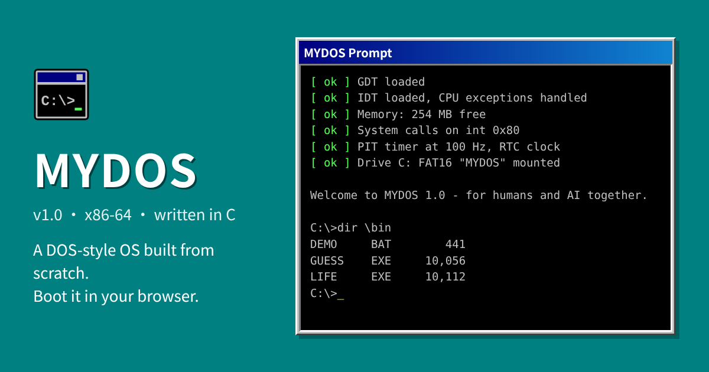

<p align="center"></p>

# MYDOS

**MYDOS 1.0** — 一個從零開始、用 C 寫的 DOS 風格作業系統，為人類和 AI 一起設計。

**▶ [直接在瀏覽器開機](https://codinguniversefromeric.github.io/mydos-online/)**

```text
MYDOS v1.0                                         2026-11-26 14:05:03
[ ok ] GDT loaded
[ ok ] IDT loaded, CPU exceptions handled
[ ok ] Memory: 254 MB free
[ ok ] System calls on int 0x80
[ ok ] PIC remapped to vectors 32-47
[ ok ] PIT timer at 100 Hz, RTC clock
[ ok ] PS/2 keyboard on IRQ1
[ ok ] Disk: QEMU HARDDISK, 32 MB
[ ok ] Drive C: FAT16 "MYDOS" mounted

  Welcome to MYDOS 1.0 - for humans and AI together.

C:\>_
```

## 功能

- x86-64 長模式，Limine 開機（BIOS 與 UEFI）
- Framebuffer 文字終端機、捲動、狀態列時鐘
- 中斷與例外處理，核心當機時顯示藍色畫面
- 實體記憶體配置、分頁、`kmalloc`
- PS/2 鍵盤（Shift、Caps Lock、Ctrl、方向鍵）
- PIT 計時器、RTC 時鐘
- ATA 硬碟驅動、FAT16 讀寫
- DOS 風格命令列：`DIR CD MD RD TYPE COPY DEL REN VOL`、萬用字元、`COPY CON`
- 程式在 ring 3 執行，有記憶體保護；程式當掉不影響系統，Ctrl+C 可結束
- 系統呼叫、ELF 載入器、迷你 C 函式庫
- 批次檔（參數、`IF`、`GOTO`）、`AUTOEXEC.BAT`、指令歷史

## 建置與執行

在 Ubuntu 或 Windows 的 WSL2 裡：

```bash
sudo apt install build-essential xorriso qemu-system-x86 dosfstools mtools git
make run
```

第一次 `make` 會自動下載 Limine（v11 預編譯檔）和 limine-protocol。

| 指令 | 作用 |
| --- | --- |
| `make` | 編核心和程式，做出 `mydos.iso`（開機光碟）和 `disk.img`（C 槽） |
| `make run` | 在 QEMU 開機；序列埠輸出同步顯示在終端機 |
| `make clean` | 清掉全部產物 |

`disk/` 資料夾的內容會被放進 C 槽，`user/programs/*.c` 會編成 `C:\BIN\*.EXE`。注意：`disk/` 或程式有變動時 `disk.img` 會重做，在 MYDOS 裡新增的檔案會消失。

## 在瀏覽器裡跑（GitHub Pages）

MYDOS 也能在網頁上開機：用 [QEMU Wasm](https://github.com/ktock/qemu-wasm) 在瀏覽器裡模擬一台真正的 x86-64 PC，序列埠接到網頁上的終端機。

```bash
make serve-web                          # 本機預覽：http://localhost:8000
./tools/publish-github-pages.sh         # 建立公開 repo、開啟 Pages、部署
```

之後每次 push 到 `main`，`.github/workflows/pages.yml` 都會自動重新建置並部署。詳見 [網頁版教學](docs/web-tutorial.md)。

### 線上留言簿

網頁版的訪客可以在 MYDOS 裡打 `SIGN` 留言，所有人用 `GUESTBOOK` 或桌面的「留言簿」都看得到。需要一個免費的 Supabase 資料庫，設定方式見 [留言簿教學](docs/guestbook-setup.md)。沒設定也能正常使用，只是留言只存在自己的分頁裡。

## 試試看

```text
HELP                    列出所有指令
DIR \BIN                看有哪些程式
DEMO Ada                批次檔示範
GUESS                   猜數字
LIFE                    生命遊戲動畫，按任意鍵結束
CRASH                   程式故意寫壞記憶體，看系統怎麼保護自己
COPY CON NOTE.TXT       打字存檔，Ctrl+Z 再 Enter 結束
SIGN                    在留言簿留言（網頁版所有訪客都看得到）
```

## 專案結構

```text
src/                核心
  main.c            開機流程
  term.c serial.c   螢幕、序列埠
  kprintf.c         格式化輸出
  gdt.c idt.c       段表、中斷表、TSS
  panic.c           例外處理、藍色當機畫面
  pic.c apic.c irq.c  中斷控制器
  keyboard.c timer.c rtc.c ata.c  驅動程式
  pmm.c vmm.c heap.c  記憶體管理
  fat.c             FAT16 檔案系統（介面：fs.h）
  process.c syscall.c  使用者程式、系統呼叫
  shell.c cmd_fs.c batch.c  命令列
user/               使用者程式
  lib/              迷你 C 函式庫
  programs/         HELLO GUESS WC UPPER LIFE CRASH
disk/               C 槽的初始內容（AUTOEXEC.BAT、README.TXT…）
web/                網頁版（index.html、QEMU Wasm 載入腳本）
tools/              下載 QEMU Wasm、發佈到 GitHub Pages 的腳本
docs/               每個里程碑的教學
```

## 教學

| 里程碑 | 版本 | 內容 |
| --- | --- | --- |
| [1](docs/milestone1-tutorial.md) | v0.1 | 開發環境、Limine 開機、framebuffer 畫字、COM1 |
| [2](docs/milestone2-tutorial.md) | v0.2 | 文字終端、捲動、kprintf、自動編譯的 Makefile |
| [3](docs/milestone3-tutorial.md) | v0.3 | GDT、IDT、例外、PIC、鍵盤、命令列 |
| [4](docs/milestone4-tutorial.md) | v0.4 | 實體記憶體、分頁、kmalloc、LAPIC |
| [5](docs/milestone5-tutorial.md) | v0.5 | PIT 計時器、RTC、狀態列時鐘 |
| [6](docs/milestone6-tutorial.md) | v0.6 | ATA 硬碟、FAT16、檔案指令 |
| [7](docs/milestone7-tutorial.md) | v0.7 | ring 3、系統呼叫、ELF、範例程式 |
| [8](docs/milestone8-tutorial.md) | v1.0 | 批次檔、AUTOEXEC.BAT、指令歷史 |
| [網頁版](docs/web-tutorial.md) | v1.0 | 序列埠鍵盤、ANSI 跳脫碼、QEMU Wasm、GitHub Pages |
| [留言簿](docs/guestbook-setup.md) | v1.0 | OSC 跳脫序列、就地修改磁碟映像、Supabase 與 Row Level Security |

每個里程碑都是一個 git commit，可以用 `git log` 和 `git show` 看每一步改了什麼。
